# used_car_market_EDA
Exploratory Data Analysis of the used car market, exploring pricing patterns, vehicle characteristics, condition, and sales performance using Python, Pandas, NumPy, and Plotly.

## Project Structure

| File | Description |
|---|---|
| `datacleaning_organized.ipynb` | Cleans the raw dataset and saves `cleaned_used_cars_dataset.csv` |
| `Visualization.ipynb` | Interactive charts and insights built on the cleaned data |
| `cleaned_used_cars_dataset.csv` | Final dataset (2,901 rows, 18 columns, no missing values) |

## Data Cleaning

| Before Cleaning | After Cleaning |
|---|---|
| 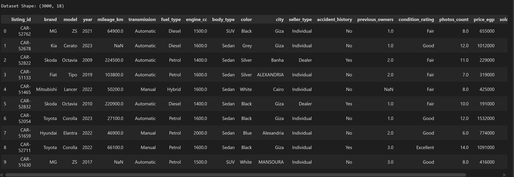 | 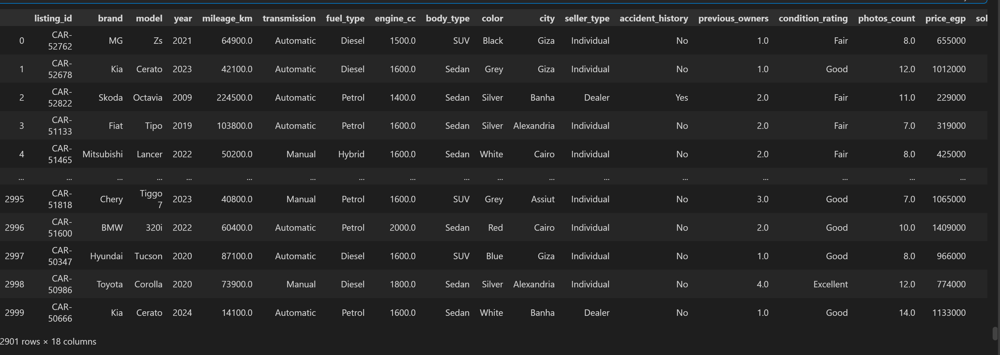 |

The raw dataset was cleaned in `datacleaning_organized.ipynb` following these steps:

### 1. Duplicates
- Removed fully duplicated rows.
- Removed rows with a repeated `listing_id` (kept the first occurrence), since each listing should be unique.

### 2. Rows with Too Many Missing Values
- Dropped rows that had 3 or more missing values.

### 3. Standardizing Text Values
- Stripped extra spaces and applied title case to `brand`, `model`, `city`, `color`, `fuel_type`, `body_type`, `seller_type`, and `transmission`.
- Unified inconsistent names, for example:
  - `Bmw` → `BMW`, `Mg` → `MG`
  - `Mercedes` / `Mercedes Benz` → `Mercedes-Benz`
  - `Auto` → `Automatic`
  - `Suv` → `SUV`
  - `320I` → `320i`

### 4. Handling Missing Values
| Column(s) | Strategy |
|---|---|
| `transmission`, `fuel_type`, `color`, `city`, `seller_type` | Filled with `"Unknown"` |
| `mileage_km`, `previous_owners` | Median of the same `year` |
| `engine_cc` | Median of the same `model` |
| `photos_count` | Filled with `0` |
| `condition_rating` | Converted to numeric (Poor=1 … Excellent=4), filled with the median of the same `accident_history`, then converted back to labels |

### 5. Outliers
| Column | Rule |
|---|---|
| `year` | Removed values outside 1926–2026 |
| `mileage_km` | Removed values above 1,000,000 km |
| `price_egp` | Removed values below 60,000 or above 5,000,000 EGP |
| `engine_cc` | Removed values below 1400 cc or above 2000 cc |

`photos_count` and `previous_owners` were checked for invalid values (negative, zero, or extreme) as well.

### Output
The cleaned data is saved as `cleaned_used_cars_dataset.csv` with no missing values.

| | Rows | Columns |
|---|---|---|
| Before cleaning | 3,000 | 18 |
| After cleaning | 2,901 | 18 |

A total of 99 rows were removed (duplicates, rows with too many missing values, and outliers).

## Data Visualization

The cleaned data is explored in `Visualization.ipynb` (13 charts, most of them interactive with Plotly). The images below are the key ones; open the notebook to hover, zoom, and rotate the 3D chart.

### 1. What do car prices look like?

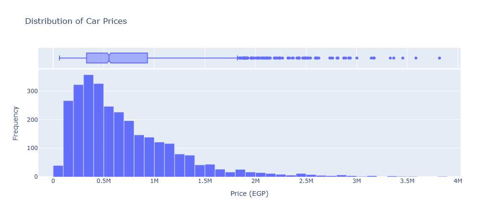

- Prices are **right-skewed**: the median is about **0.55M EGP**, and most cars fall between **0.33M and 0.95M**.
- About 4% of listings (115 cars) are above ~1.8M EGP. These are **real prices, not errors**: ~83% are Mercedes-Benz and BMW from 2020 or newer, so they were kept.
- A **log transformation** is recommended before modeling.

### 2. What drives the price?

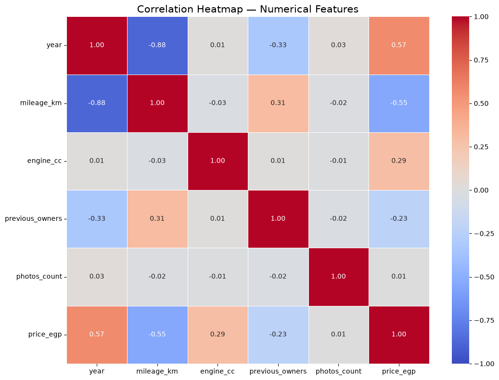

- **`year`** has the strongest positive link with price (~0.57), followed by `engine_cc` (~0.29).
- **`mileage_km`** is negatively linked with price (~-0.55).
- `year` and `mileage_km` are strongly correlated with each other (~-0.88), so watch for multicollinearity in linear models.
- `photos_count` is almost uncorrelated with everything.

| Year vs Price | Price vs Mileage |
|---|---|
| 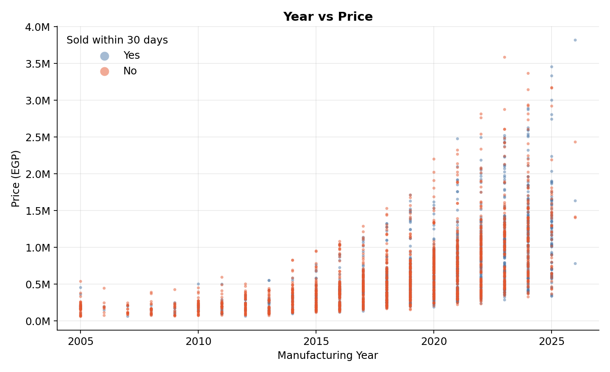 | 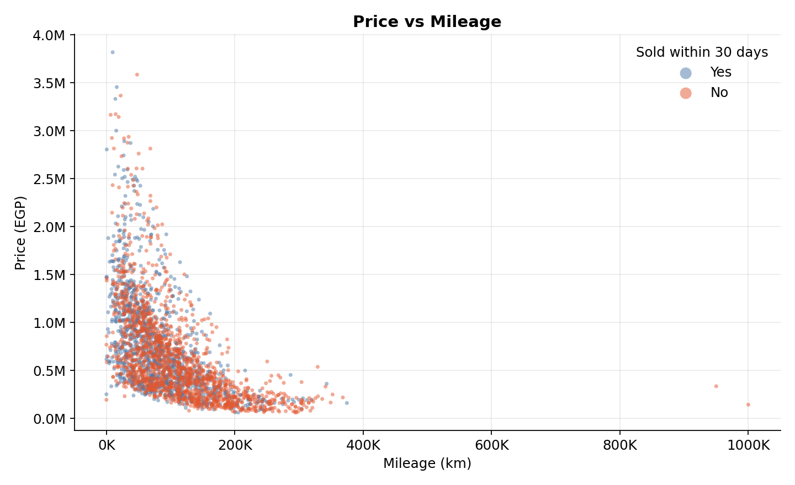 |

- Price rises with the manufacturing year, and the increase gets much sharper from about **2014 onward**.
- Higher mileage means a lower price. Two listings look like **data-entry errors**: a Fiat Tipo 2014 at **999,999 km** and a Renault Logan 2020 at **950,000 km**.

### 3. Which brands are listed and how are they priced?

| Number of Cars by Brand | Median Price by Brand |
|---|---|
| 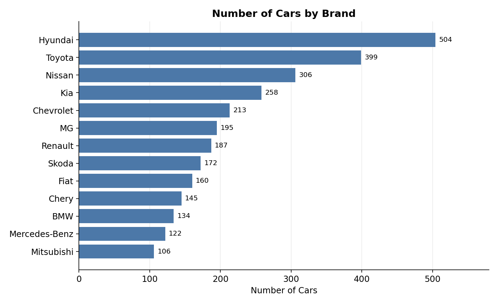 | 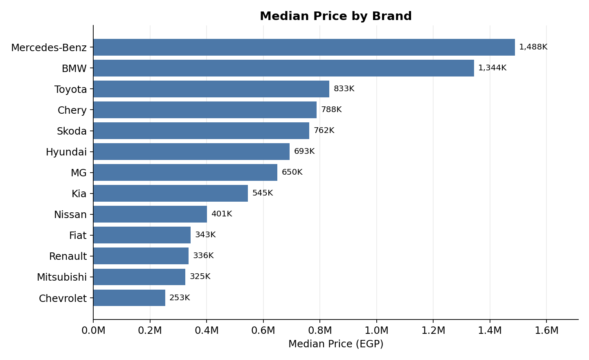 |

- **Hyundai** (504), **Toyota** (399), and **Nissan** (306) make up about 42% of the listings.
- **Mercedes-Benz** (~1.49M EGP) and **BMW** (~1.34M EGP) have the highest median prices; **Chevrolet** (~253K EGP) has the lowest.

### 4. What affects selling within 30 days?

| Overall | Correlation with the Target |
|---|---|
| 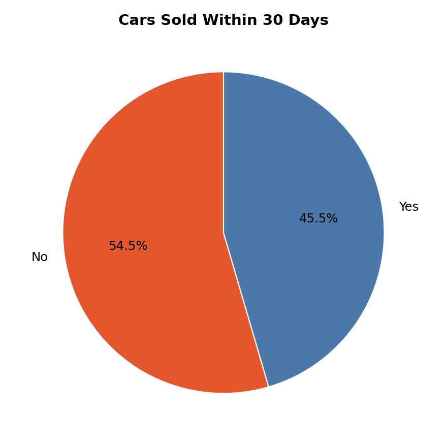 | 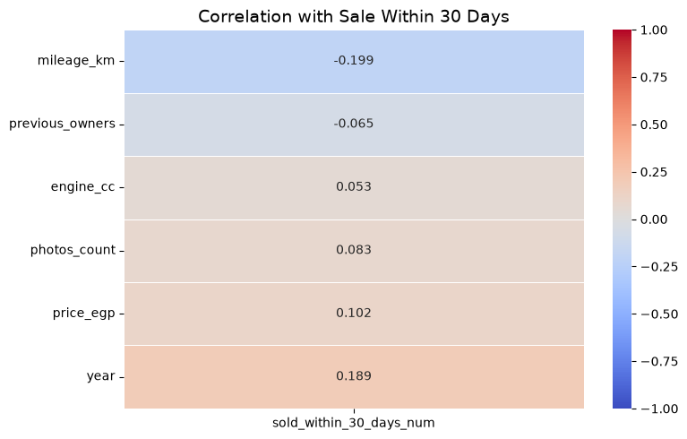 |

- **45.5%** of the listings were sold within 30 days (1,319 Yes vs 1,582 No).
- All numerical correlations with the target are weak (none above ±0.20). The strongest are `mileage_km` (-0.20) and `year` (+0.19).

| Sales Rate by Year | Sales Rate by Brand |
|---|---|
| 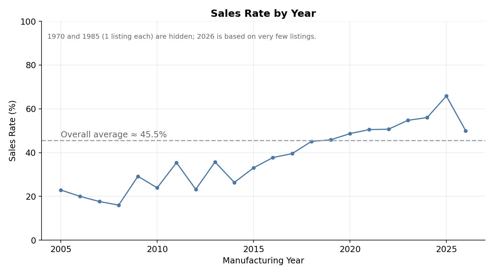 | 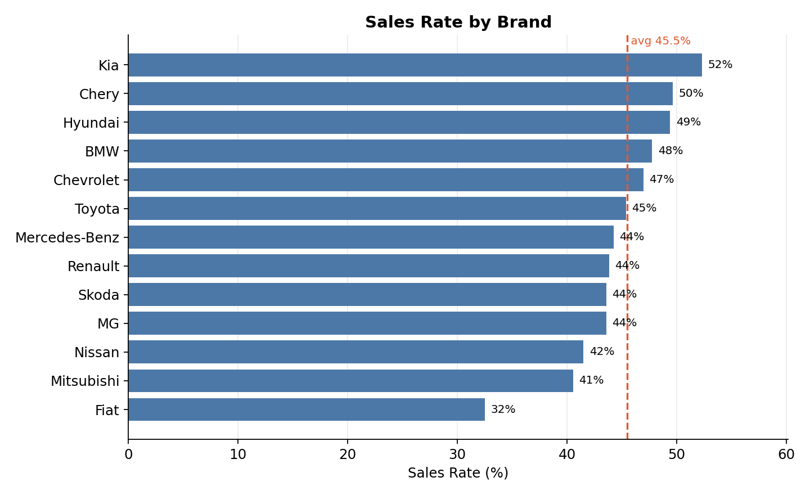 |

- **Newer cars sell faster**: from ~16–23% for 2005–2008 cars up to ~66% for 2025 cars.
- **Kia** (~52%), Chery (~50%), and Hyundai (~49%) sell the fastest; **Fiat** (~33%) the slowest.
- Premium brands are **not** faster sellers (BMW ~48%, Mercedes-Benz ~44%).

### 5. Fuel type and transmission

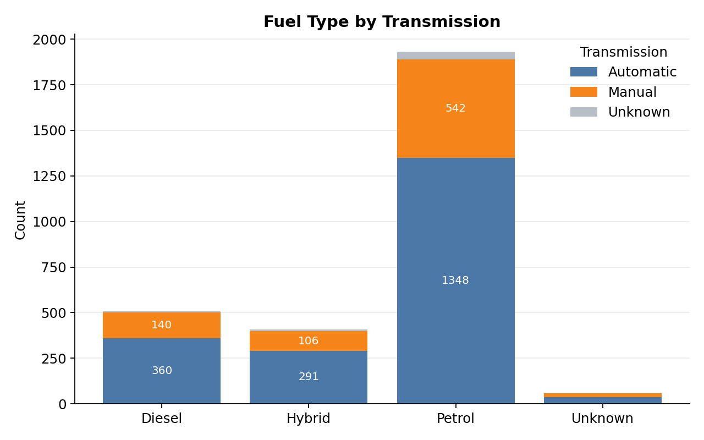

- **Petrol** dominates the dataset (~1,931 listings), followed by Diesel (507) and Hybrid (406).
- **Automatic** is more common than manual in every fuel type.

### Key Takeaways
- **Year** and **mileage** are the main drivers of price, and **brand** matters a lot for the typical price level.
- No single numerical feature predicts whether a car sells within 30 days; categorical features and combinations are needed.
- All findings are **associations**, not proof of cause and effect, and prices are **asking prices**.

## How to Run

```bash
pip install pandas numpy matplotlib seaborn plotly statsmodels
jupyter notebook
```

Run `datacleaning_organized.ipynb` first, then `Visualization.ipynb` (`statsmodels` is needed for the trendline in the mileage chart).
